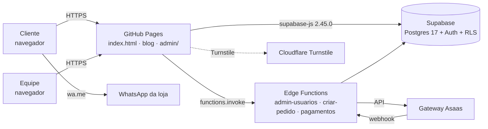

# 02 · TRD — Documento de Requisitos Técnicos

## 1. Visão geral da arquitetura



- **Sem build, sem servidor próprio.** HTML/CSS/JS estático servido pelo GitHub Pages (a partir do `main`).
- **Supabase** (projeto `elaczoriyaejkixkubxn`, sa-east-1) concentra dados, autenticação, regras e funções.
- **Edge Functions (Deno)** só para o que exige segredo ou chave de serviço.

## 2. Stack

| Camada | Tecnologia |
|---|---|
| Front público | HTML5, CSS, JS (Poppins + Kaushan via Google Fonts) |
| Painel | Arquivo único `admin/index.html` (IIFE ES5-style), `marca.js`, `ajuda.js` |
| Cliente de dados | supabase-js 2.45.0 (jsDelivr) |
| Banco | PostgreSQL 17 (Supabase), PL/pgSQL, RLS |
| Serverless | Supabase Edge Functions (Deno/TypeScript) |
| Pagamentos | Asaas (adaptador) · modos `nenhum` / `teste` / `asaas` |
| Anti-bot | Cloudflare Turnstile (função `criar-pedido`, não implantada) |
| Hospedagem | GitHub Pages — `https://martonnedias.github.io/tqracai/` |
| Testes | Playwright (Chromium) + stub do Supabase + Postgres local |

## 3. Estrutura do repositório

```
index.html                # site público
blog/                     # páginas e blog.css
admin/index.html          # painel Central TQR
admin/marca.js            # pacote de marca (cores, nome, vocabulário, textos)
admin/ajuda.js            # conteúdo de ajuda por módulo/campo
admin/MARCA.md · SISTEMA-DE-DESIGN.md
supabase/migrations/      # 01–21 (SQL versionado)
supabase/functions/       # admin-usuarios · criar-pedido · pagamentos
supabase/LEIA-ME.md
PRODUCT.md · DESIGN.md · HANDOFF.md
docs/                     # este conjunto
.impeccable/              # críticas e contrato de superfície de design
```

## 4. Segurança

### 4.1 Autenticação e autorização
- Equipe: Supabase Auth (e-mail/senha; MFA recomendado). Tabela `perfis` liga usuário → perfil.
- Perfis: `dono` (`*`), `gerente`, `atendente`, `entregador`.
- Permissões: `pedidos.{ver,criar,status,status_entrega,cancelar,editar}`, `clientes.{ver,editar}`, `produtos.gerir`, `promocoes.gerir`, `config.gerir`, `financeiro.{ver,gerir}`, `custos.{ver,gerir}`, `estoque.{ver,gerir}`.
- Funções auxiliares: `tem_permissao(p)`, `is_admin()`, `eh_dono()`, `minhas_permissoes()`.
- **Fonte da verdade = RLS + RPC `SECURITY DEFINER`.** O front só esconde menus (`data-perm`, `can()`).

### 4.2 Cliente final
- Sem login Supabase: identificação por **telefone + código** (`solicitar_codigo` / `verificar_codigo`), sessão em `sessoes_cliente`.
- Tabelas sensíveis sem acesso direto do papel `anon`; tudo via RPC.

### 4.3 Segredos
- Chave anon (publicável) no front; **service role e chaves de gateway só em secrets de Edge Function**.
- Webhook de pagamento validado por token (`GATEWAY_WEBHOOK_TOKEN`) e **idempotente** (`pagamento_eventos`).

### 4.4 Checklist de endurecimento
MFA do dono · proteção contra senha vazada · Turnstile em `criar-pedido` · limitar tentativas de código · revisar `get_advisors` do Supabase a cada migration · backups (Pro).

## 5. APIs

### 5.1 RPCs públicas (site)
`obter_vitrine`, `obter_precos`, `obter_config_publica`, `obter_contador`, `simular_pedido(_v3)`, `criar_pedido(_v2,_v3)`, `cadastrar_cliente`, `solicitar_codigo`, `verificar_codigo`, `consultar_saldo`, `listar/salvar/apagar_endereco`, `pagamento_publico`.

### 5.2 RPCs administrativas
`admin_criar_pedido(_v2,_v3)`, `admin_*` (pontos, resgate, aniversário, cliente), `crm_clientes/registrar/atualizar`, `salvar_ficha`, `salvar_ficha_opcao`, `definir_custo_insumo`, `anular_compra`, `registrar_movimento_estoque`, `cmv_mes`, `dados_loja`, `pagamento_registrar/admin_cobrar_teste/admin_simular/admin_estornar_teste`, `nota_emitir`, `nota_cancelar`, `rel_vendas/produtos/financeiro/clientes`.

### 5.3 Edge Functions
| Função | Papel | Estado |
|---|---|---|
| `admin-usuarios` | Criar/editar usuários (usa service role) | Implantada v3 |
| `criar-pedido` | Pedido com verificação Turnstile | Não implantada |
| `pagamentos` | Criar cobrança e receber webhook Asaas | Não implantada |

## 6. Regras de negócio no servidor
- **Motor de preço:** `motor_pedido` + `app_private.calcular_montagens`; o cliente nunca envia preço final.
- **Estados do pedido:** trigger `pedidos_guarda` valida transições; `pedidos_evento` grava histórico.
- **Pago →** `pedidos_estoque` (baixa por receita), `pedidos_financeiro` (caixa + pontos), `pedidos_nota_auto` (NF se `nf_emissao_auto`).
- **Custo:** média ponderada das últimas `custo_compras_n` compras (`compras_calcula`, `compras_aplica`, `historico_custo_*`).
- **Pagamento:** `app_private.pagamento_aplicar` aprova de forma idempotente.
- **Nota fiscal:** simulada; `producao_indisponivel` bloqueia ambiente real.

## 7. Integrações
- **WhatsApp:** link `wa.me` com texto pré-formatado (sem API oficial). Futuro: API oficial com modelos.
- **Asaas:** cobrança Pix, webhook, estorno (teste). Modo padrão `nenhum`.
- **Turnstile:** planejado.

## 8. Front-end do painel
- Helpers: `el`, `brl`, `$`, `can`, `campo`, `confirmar`, `toast`, `abrirAba`.
- **Atualização automática:** wrapper em `sb.from/rpc/functions.invoke` chama `mudou()` → `atualizaSilencioso` (debounce).
- **Aviso de versão:** banner `#novaVersao`.
- **Marca:** `aplicaMarca()` aplica variáveis CSS, textos e vocabulário (MutationObserver).
- **Gráficos:** SVG próprio (barras, linhas, pizza, barras horizontais, pulso), tooltip customizado, alternativa em tabela.
- **Mobile:** barra inferior (`#bnav`) + diálogo "Mais".
- **Impressão:** `#printArea` + `imprimirDoc`.

## 9. Desempenho
- Sem framework; JS único. Agregações em views (`v_resumo_dia`, `v_fluxo_mensal`…).
- Kanban limita cartões por coluna (`kLim`, "Mostrar mais").
- Pendências: self-host de Poppins/Kaushan (woff2), `prefers-reduced-motion` em animações.

## 10. Testes
- Scripts Playwright em `scratchpad/t` (test.js, test3…test19) com **stub do Supabase** (`window.__X` por tabela, `window.__rpc`).
- Postgres local (porta 5499) aplica as 21 migrations para validar SQL.
- Regra: toda mudança passa pelos testes antes do PR.

## 11. Deploy e versionamento
1. Branch de trabalho → commit → PR → **dono mescla** no `main`.
2. GitHub Pages publica o `main` (alterações não mescladas ficam invisíveis).
3. Migrations aplicadas ao Supabase de produção (via MCP/CLI) e versionadas em `supabase/migrations/`.
4. Edge Functions: `supabase functions deploy <nome>`.
5. Painel avisa o usuário quando há nova versão.

## 12. Design técnico — módulos e licenças (fase SaaS)

```sql
-- esboço
create table modulos (codigo text primary key, nome text, obrigatorio boolean default false);
create table planos (codigo text primary key, nome text, preco_cents int);
create table plano_modulos (plano text references planos, modulo text references modulos, primary key(plano, modulo));
create table instancia_modulos (modulo text primary key references modulos, ativo boolean, ate timestamptz);
create function modulo_ativo(m text) returns boolean language sql stable security definer as
$$ select coalesce((select ativo and (ate is null or ate>now()) from instancia_modulos where modulo=m), false) $$;
```
- `modulo_ativo()` entra nas **policies** e nas **RPCs** (ex.: `rel_*` exige `gestao`).
- Front lê `minhas_permissoes()` + `meus_modulos()` e oculta abas.
- **Licença:** instância consulta o painel mestre periodicamente (token assinado), com cache e prazo de tolerância.
- **Painel mestre:** projeto Supabase separado do dono do produto; webhook Asaas → atualiza `instancia_modulos` da instância (via Edge Function com service role).
- **Atualizações:** `migrations` idempotentes + tabela `versao_instancia`; script que aplica migrations em cada projeto.

### 12.1 Cadastro de assinantes (projeto mestre)
Um projeto Supabase **separado** (do dono do produto) guarda o cadastro; as lojas não enxergam umas às outras.
- Tabelas: `assinantes`, `assinante_contatos`, `assinante_contratos`, `assinante_instancias`, `assinante_eventos` (ver `05-BANCO-DE-DADOS.md` §9.1).
- Acesso: só usuários do mestre (RLS por `eh_equipe_mestre()`); sem acesso público.
- Sincronia com a loja: Edge Function do mestre chama a loja (service role dela, guardada como secret do mestre) para `admin_definir_modulo`/`admin_aplicar_plano`; a loja também consulta uma **licença** assinada (cache + tolerância).
- Webhook do gateway atualiza `assinante_contratos.status` e dispara a ativação/suspensão de módulos.

### 12.2 Marca do painel
- Tabela `marca_painel` (1 linha, `dados jsonb`); `obter_marca()` é pública (a tela de login usa), devolve `null` se o módulo `personalizacao` estiver desligado; `admin_salvar_marca`/`admin_restaurar_marca` exigem `config.gerir` + módulo ativo.
- Validação no servidor (`app_private.marca_valida`): cores `#rrggbb`, fontes de lista liberada, logo `https://` ou caminho relativo, tamanhos máximos.
- Painel: `aplicaMarca(M)` aplica variáveis CSS (`--casca`, `--brand`, `--ouro`, `--fundo`, `--font`, `--f-ui`, `--f-destaque`), carrega a fonte do Google Fonts sob demanda e mescla com `marca.js` (o banco vence).

## 13. Dívidas técnicas
Fontes externas; arquivo único grande (`admin/index.html`); estados `.fld.err` e `.btn.load`; `prefers-reduced-motion` em `gira`; achados do relatório de acessibilidade (pendentes); textos de marca ainda fixos em pontos do site público; 18 dívidas listadas em `admin/SISTEMA-DE-DESIGN.md`.
