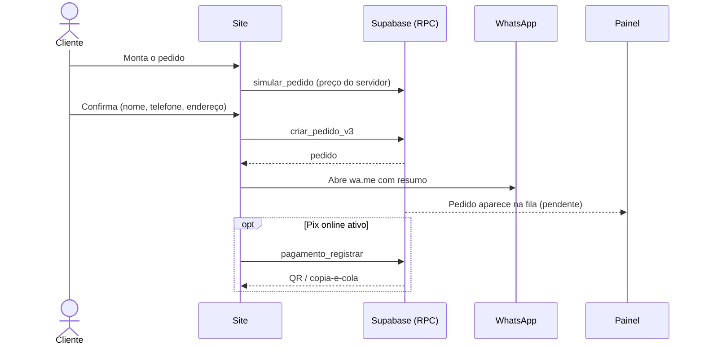
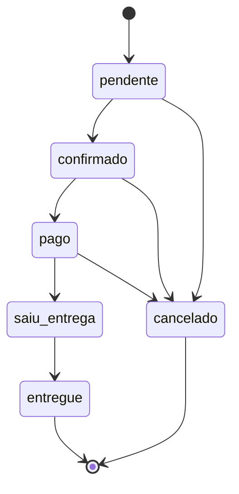
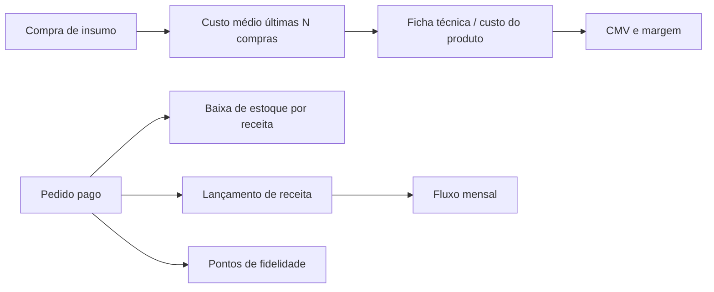
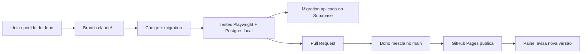
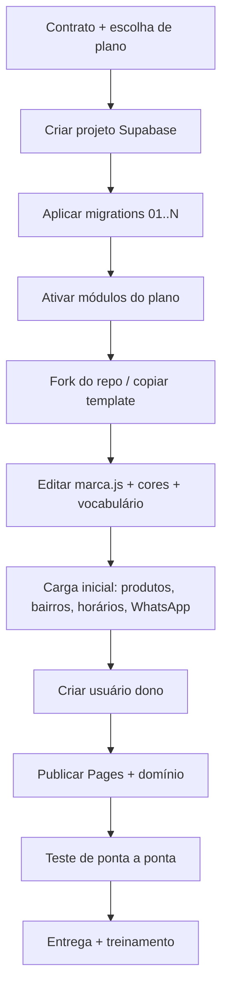

# 03 · Fluxo de Trabalho

## 1. Pedido do cliente (ponta a ponta)

## 2. Máquina de estados do pedido

Efeitos automáticos (gatilhos): **pago** → baixa de estoque, receita no caixa, pontos de fidelidade, nota (se automática). **cancelado** → estorno de estoque/caixa quando aplicável. Todo passo grava em `pedido_eventos`.

## 3. Rotina da operação (dia a dia)

| Quando | Quem | O que faz | Onde |
|---|---|---|---|
| Abertura | Dono/Gerente | Confere aviso, horário, estoque baixo | Início, Estoque |
| Durante | Atendente | Confirma pedidos, cria pedidos manuais, cobra Pix | Pedidos, Novo pedido, Pagamentos |
| Durante | Entregador | Marca "saiu para entrega" / "entregue" | Pedidos |
| Fechamento | Dono | Confere caixa, lança despesas, imprime relatório | Financeiro, Relatórios |
| Semanal | Dono | Registra compras de insumo, revisa custo/margem | Estoque, Custos |
| Semanal | Dono/Marketing | Campanha para clientes em risco, aniversariantes | CRM, Mensagens |
| Mensal | Dono | Relatório PDF analítico, fluxo mensal, contador | Relatórios, Notas |

## 4. Fluxo financeiro, custo e estoque

## 5. Marketing e fidelidade

1. CRM classifica clientes (ativo, em risco, novo, aniversariante).
2. Dono escolhe segmento em **Mensagens** → campanha rápida abre WhatsApp com texto pronto.
3. Contato fica registrado em `interacoes_crm` / `mensagens_crm`; tarefas em `tarefas_crm`.
4. Pontos: R$ → pontos (`pontos_por_real`); brinde a cada `pontos_por_brinde`; resgate pelo painel.

## 6. Fluxo de desenvolvimento (como mudamos o sistema)

Regras: nunca empurrar para `main` direto; se o PR já foi mesclado, recomeçar a branch de `origin/main`; atualizar **Ajuda** (`ajuda.js`) e o aviso de versão a cada mudança visível.

## 7. Implantação de um novo cliente (modelo "uma instância por cliente")

Meta: automatizar B–I num **assistente de implantação** (fase 3 do plano).

## 8. Suporte e mudança de plano
1. Cliente pede módulo extra → painel mestre ativa `instancia_modulos` → menu aparece no próximo carregamento.
2. Inadimplência (webhook Asaas) → módulos pagos ficam `ativo=false`; Núcleo continua, dados preservados.
3. Atualização de versão: aplicar migrations novas por instância, registrar em `versao_instancia`.
4. Incidente: verificar Supabase (pausa/limite), logs (`query_logs`), advisors; comunicar cliente.
