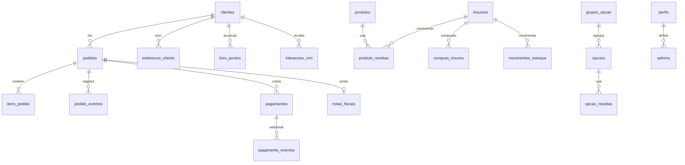

# 05 · Banco de Dados

**SGBD:** PostgreSQL 17 (Supabase, projeto `elaczoriyaejkixkubxn`, sa-east-1)
**Segurança:** RLS ativo nas **33 tabelas** · 73 policies · 13 triggers · 8 views
**Versionamento:** `supabase/migrations/` (01–21), aplicadas em produção

## 1. Mapa por domínio



## 2. Tabelas

| Domínio | Tabelas |
|---|---|
| **Vendas** | `pedidos`, `itens_pedido`, `pedido_eventos`, `bairros_entrega`, `formas_pagamento`, `promocoes` |
| **Catálogo** | `produtos`, `grupos_opcao`, `opcoes`, `produto_receitas`, `opcao_receitas` |
| **Clientes** | `clientes`, `enderecos_cliente`, `sessoes_cliente`, `codigos_verificacao`, `livro_pontos` |
| **CRM/Marketing** | `interacoes_crm`, `mensagens_crm`, `tarefas_crm` |
| **Financeiro** | `lancamentos`, `categorias_financeiras` |
| **Custos/Estoque** | `insumos`, `compras_insumo`, `movimentos_estoque`, `custos_produto`, `historico_custo_insumo`, `historico_custo_produto` |
| **Pagamentos** | `pagamentos`, `pagamento_eventos` |
| **Fiscal** | `notas_fiscais` |
| **Acesso/Config** | `admins`, `perfis`, `configuracoes` |

## 3. Views
`v_clientes_resumo`, `v_cmv_mes`, `v_custo_opcao`, `v_custo_produto`, `v_fluxo_mensal`, `v_garrafas_mes`, `v_resumo_dia`, `v_saldo_pontos`.

## 4. Triggers
| Trigger | Efeito |
|---|---|
| `pedidos_guarda` | Valida transições de status |
| `pedidos_evento` | Grava histórico |
| `pedidos_estoque` | Baixa insumos ao pagar |
| `pedidos_financeiro` | Receita no caixa e pontos |
| `pedidos_nota_auto` | Emite nota se `nf_emissao_auto` |
| `pedidos_touch`, `clientes_touch` | `atualizado_em` |
| `itens_custo` | Congela custo do item |
| `compras_calcula` / `compras_aplica` | Calcula e aplica compra ao custo médio |
| `movimentos_aplica` | Atualiza saldo do insumo |
| `configuracoes_valida` | Valida chaves/valores |
| `promocoes_valida` | Valida regras de promoção |

## 5. Funções (RPC)
Públicas: `obter_vitrine`, `obter_precos`, `obter_config_publica`, `obter_contador`, `simular_pedido(_v3)`, `criar_pedido(_v2,_v3)`, `cadastrar_cliente`, `solicitar_codigo`, `verificar_codigo`, `consultar_saldo`, `listar/salvar/apagar_endereco`, `pagamento_publico`.
Admin: `admin_criar_pedido(_v2,_v3)`, `admin_*` (pontos, resgate, aniversário, cliente), `crm_*`, `salvar_ficha`, `salvar_ficha_opcao`, `definir_custo_insumo`, `anular_compra`, `registrar_movimento_estoque`, `cmv_mes`, `dados_loja`, `pagamento_*`, `nota_emitir`, `nota_cancelar`, `rel_vendas/produtos/financeiro/clientes`, `minhas_permissoes`.
Internas (schema `app_private`): `motor_pedido`, `calcular_montagens`, `pagamento_aplicar`.

## 6. Segurança (RLS e permissões)
- Padrão: toda tabela com RLS; `anon` só executa RPCs públicas.
- Policies usam `tem_permissao('x.y')`, `is_admin()`, `eh_dono()`.
- Perfis: `dono` (`*`), `gerente`, `atendente`, `entregador`.
- Permissões: `pedidos.ver/criar/status/status_entrega/cancelar/editar`, `clientes.ver/editar`, `produtos.gerir`, `promocoes.gerir`, `config.gerir`, `financeiro.ver/gerir`, `custos.ver/gerir`, `estoque.ver/gerir`.

## 7. Chaves de `configuracoes`
`aniversario_pontos`, `aviso_ativo`, `aviso_site`, `contador_ajuste`, `contador_base`, `crm_*`, `custo_compras_n`, `custo_metodo`, `gateway_ativo`, `horario_abre`, `horario_fecha`, `loja_*` (razão social, endereço, e-mail…), `margem_alvo_pct`, `nf_*`, `pedido_min`, `pedido_max`, `pix_expira_min`, `pontos_por_brinde`, `pontos_por_real`, `preco_5mais`, `preco_combo3`, `preco_unitario`, `whatsapp_loja`, `whatsapp_pedidos`.

## 8. Migrations
| # | Tema |
|---|---|
| 01–11 | Base: catálogo, clientes, pedidos, preços, pontos, permissões, usuários |
| 12 | Custos e estoque |
| 15 | Personalização |
| 17 | CRM |
| 18 | Impressão |
| 19 | Pagamentos (Asaas, webhook idempotente) |
| 20 | Nota fiscal (homologação) |
| 21 | Relatórios |
| 22 | Módulos e planos |
| 23 | Marca do painel (cores, fontes, nome, logo) |

(Detalhe de cada arquivo em `supabase/LEIA-ME.md`.)

## 9. Proposta: módulos, planos e licenças (migration 22+)

```sql
create table modulos (
  codigo text primary key, nome text not null, obrigatorio boolean default false);
create table planos (
  codigo text primary key, nome text not null, preco_cents int);
create table plano_modulos (
  plano text references planos, modulo text references modulos,
  primary key (plano, modulo));
create table instancia_modulos (
  modulo text primary key references modulos,
  ativo boolean not null default false, ate timestamptz, origem text);
create table licenca (
  id int primary key default 1, token text, validado_em timestamptz,
  tolerancia_dias int default 7);
create table versao_instancia (
  versao int primary key, aplicada_em timestamptz default now());

create function modulo_ativo(m text) returns boolean
language sql stable security definer set search_path = public as $$
  select coalesce((select ativo and (ate is null or ate > now())
                   from instancia_modulos where modulo = m), false) $$;
```
Uso: `using (tem_permissao('financeiro.ver') and modulo_ativo('gestao'))` em policies e `if not modulo_ativo('marketing') then raise exception ...` em RPCs. Seeds: Núcleo sempre `ativo`.

### 9.1 Projeto mestre: cadastro de assinantes (proposta)
```sql
create table assinantes (
  id uuid primary key default gen_random_uuid(),
  razao_social text not null, nome_fantasia text, documento text unique,   -- CNPJ/CPF
  segmento text, cidade text, uf char(2), site text, logo_url text,
  status text not null default 'teste' check (status in ('teste','ativo','inadimplente','suspenso','cancelado')),
  criado_em timestamptz default now()
);
create table assinante_contatos (
  id uuid primary key default gen_random_uuid(), assinante_id uuid references assinantes on delete cascade,
  tipo text check (tipo in ('responsavel','financeiro','tecnico')), nome text, email text, whatsapp text);
create table assinante_contratos (
  id uuid primary key default gen_random_uuid(), assinante_id uuid references assinantes on delete cascade,
  plano text, addons text[] default '{}', ciclo text check (ciclo in ('mensal','anual')),
  valor_centavos int, desconto_pct numeric(5,2) default 0, inicio date, vencimento date,
  gateway_cliente text, gateway_assinatura text, aceite_lgpd_em timestamptz, aceite_versao text);
create table assinante_instancias (
  id uuid primary key default gen_random_uuid(), assinante_id uuid references assinantes on delete cascade,
  supabase_ref text, url_site text, url_painel text, dominio text,
  versao_migracao int, ultimo_acesso timestamptz, saude text);
create table assinante_eventos (
  id bigint generated always as identity primary key, assinante_id uuid references assinantes on delete cascade,
  tipo text, detalhe jsonb, em timestamptz default now(), por uuid);
```
RLS: somente equipe do mestre; nenhuma policy para `anon`.

### 9.2 Marca do painel (migração 23, já aplicada)
`marca_painel(id=1, dados jsonb, atualizado_em)`; funções `obter_marca()`, `admin_salvar_marca(jsonb)`, `admin_restaurar_marca()`, `app_private.marca_valida(jsonb)`.

**Multi-tenant (fase futura):** adicionar `loja_id` em todas as tabelas, RLS por `loja_id` do JWT e `modulo_ativo(loja, m)`.

## 10. Operação
Backups (Pro) · `get_advisors` após cada migration · índices em `pedidos(status, criado_em)`, `itens_pedido(pedido_id)`, `livro_pontos(cliente_id)` · apagar pedidos de teste antes de produção · plano Free pausa por inatividade.
